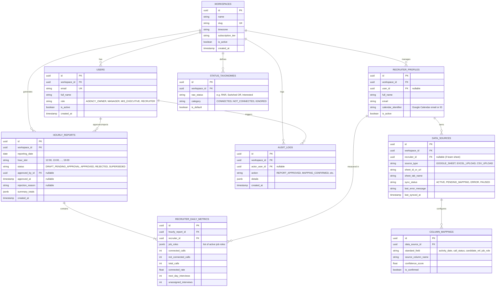

# RecruiterPulse — Technical Architecture & Database Schema

**Document Version:** 1.0  
**Associated PRD:** [PRD_v1.1.md](file:///c:/Users/guruu/OneDrive/Desktop/RecruiterPulse/docs/PRD_v1.1.md)  
**Database Engine:** PostgreSQL 15+ (Production) / SQLite (Local Test/Dev)  
**ORM:** SQLAlchemy 2.0+ (Declarative Mapped typing)

---

## 1. High-Level Architecture Overview

RecruiterPulse is engineered around a **Stateless Ingestion & Aggregate Storage** pattern. To strictly comply with the **Digital Personal Data Protection (DPDP) Act 2023**, the database never stores candidate identities, phone numbers, or resumes.

```
┌───────────────────────────────────────────────────────────────────────────┐
│                           External Sources                                │
│   • Google Sheets (via Service Account)   • Excel / CSV Files (Upload)    │
│   • Google Calendar API (Interview Schedule)                              │
└─────────────────────────────────────┬─────────────────────────────────────┘
                                      │
                                      ▼
┌───────────────────────────────────────────────────────────────────────────┐
│                      FastAPI Ingestion & Calc Worker                      │
│                                                                           │
│   1. Read Sheet in-memory (Pandas DataFrame)                              │
│   2. Match Columns (ColumnMapping) & Classify Status (StatusTaxonomy)     │
│   3. Deduplicate rows within 3-minute window                              │
│   4. Calculate Totals (Connected, Not Connected, Total, Rate)             │
│   5. Match T+1 Calendar events to Recruiters (Attribution Hierarchy)      │
│   6. Purge Candidate PII from memory                                      │
└─────────────────────────────────────┬─────────────────────────────────────┘
                                      │
                                      ▼
┌───────────────────────────────────────────────────────────────────────────┐
│                      PostgreSQL (Relational Store)                        │
│                                                                           │
│  [workspaces] ────< [users]                                              │
│       │                                                                   │
│       ├───────────< [recruiter_profiles] ───< [data_sources]              │
│       │                                             │                     │
│       │                                             └──< [column_mappings]│
│       ├───────────< [status_taxonomies]                                   │
│       │                                                                   │
│       ├───────────< [hourly_reports] ───────< [recruiter_daily_metrics]   │
│       │                                                                   │
│       └───────────< [audit_logs]                                          │
└─────────────────────────────────────┬─────────────────────────────────────┘
                                      │
                                      ▼
┌───────────────────────────────────────────────────────────────────────────┐
│                          Distribution Layers                              │
│   • Next.js Management Dashboard   • 1-Click WhatsApp Clipboard Formatter │
│   • MIS Approval Portal            • PDF / Excel Export Engines           │
└───────────────────────────────────────────────────────────────────────────┘
```

---

## 2. Entity-Relationship Diagram (ERD)



---

## 3. Database Table Definitions & Schemas

### 3.1 `workspaces` (Tenant Root)
Every agency operates under a unique workspace with complete row-level isolation.
* `id` (`UUID`, PK, default `gen_random_uuid()`)
* `name` (`VARCHAR(150)`, NOT NULL): e.g., "Apex Staffing India"
* `slug` (`VARCHAR(60)`, UNIQUE, NOT NULL, indexed): e.g., "apex-staffing"
* `timezone` (`VARCHAR(50)`, default `'Asia/Kolkata'`): Ensures all date/hour calculations match Indian Standard Time.
* `service_account_email` (`VARCHAR(255)`, nullable): Dedicated Google service account address for this agency.
* `subscription_tier` (`VARCHAR(30)`, default `'TRIAL'`): `TRIAL`, `STARTER`, `PRO`, `ENTERPRISE`.
* `is_active` (`BOOLEAN`, default `TRUE`)
* `created_at` / `updated_at` (`TIMESTAMPTZ`)

### 3.2 `users` (Authentication & RBAC)
* `id` (`UUID`, PK)
* `workspace_id` (`UUID`, FK `workspaces.id` ON DELETE CASCADE, indexed)
* `email` (`VARCHAR(255)`, UNIQUE, NOT NULL, indexed)
* `hashed_password` (`VARCHAR(255)`, NOT NULL)
* `full_name` (`VARCHAR(150)`, NOT NULL)
* `role` (`VARCHAR(30)`, NOT NULL): `AGENCY_OWNER`, `MANAGER`, `MIS_EXECUTIVE`, `RECRUITER`
* `is_active` (`BOOLEAN`, default `TRUE`)
* `created_at` / `updated_at` (`TIMESTAMPTZ`)

### 3.3 `recruiter_profiles` (Recruiter Roster)
Agencies track recruiters whether or not they have a portal user login.
* `id` (`UUID`, PK)
* `workspace_id` (`UUID`, FK `workspaces.id` ON DELETE CASCADE, indexed)
* `user_id` (`UUID`, FK `users.id` ON DELETE SET NULL, nullable, indexed): Optional link if the recruiter has login credentials.
* `full_name` (`VARCHAR(150)`, NOT NULL)
* `email` (`VARCHAR(255)`, nullable): Used for calendar invite attendee matching.
* `calendar_identifier` (`VARCHAR(255)`, nullable): Google Calendar email or calendar ID for interview scraping.
* `is_active` (`BOOLEAN`, default `TRUE`)
* `created_at` / `updated_at` (`TIMESTAMPTZ`)

### 3.4 `data_sources` (Spreadsheet Connections)
* `id` (`UUID`, PK)
* `workspace_id` (`UUID`, FK `workspaces.id` ON DELETE CASCADE, indexed)
* `recruiter_id` (`UUID`, FK `recruiter_profiles.id` ON DELETE CASCADE, nullable, indexed): Null if the sheet is an agency-wide consolidated master sheet.
* `source_type` (`VARCHAR(30)`, NOT NULL): `GOOGLE_SHEET`, `EXCEL_UPLOAD`, `CSV_UPLOAD`.
* `sheet_id_or_url` (`TEXT`, NOT NULL): Google Sheet ID or storage key.
* `sheet_tab_name` (`VARCHAR(100)`, nullable): Specific tab to parse (defaults to first/active tab).
* `sync_status` (`VARCHAR(30)`, default `'ACTIVE'`): `ACTIVE`, `PENDING_MAPPING`, `ERROR`, `PAUSED`.
* `last_synced_at` (`TIMESTAMPTZ`, nullable)
* `last_error_message` (`TEXT`, nullable)
* `created_at` / `updated_at` (`TIMESTAMPTZ`)

### 3.5 `column_mappings` (Field Normalization)
* `id` (`UUID`, PK)
* `data_source_id` (`UUID`, FK `data_sources.id` ON DELETE CASCADE, indexed)
* `standard_field` (`VARCHAR(50)`, NOT NULL): `activity_date`, `call_status`, `candidate_ref`, `job_role`.
* `source_column_name` (`VARCHAR(150)`, NOT NULL): Header as it appears in the spreadsheet.
* `confidence_score` (`FLOAT`, NOT NULL): Heuristic detection confidence ($0.0 \to 1.0$).
* `is_confirmed` (`BOOLEAN`, default `FALSE`): Verified by MIS executive.
* `sample_values` (`JSONB`, nullable): First 3–5 representative sample values for audit/confirmation UI.
* `created_at` / `updated_at` (`TIMESTAMPTZ`)

### 3.6 `status_taxonomies` (Indian Status Normalization)
* `id` (`UUID`, PK)
* `workspace_id` (`UUID`, FK `workspaces.id` ON DELETE CASCADE, indexed)
* `raw_status` (`VARCHAR(100)`, NOT NULL, indexed): e.g., "RNR", "Switched Off", "Screening Done".
* `category` (`VARCHAR(30)`, NOT NULL): `CONNECTED`, `NOT_CONNECTED`, `IGNORED`.
* `is_default` (`BOOLEAN`, default `FALSE`)
* Unique constraint: `(workspace_id, LOWER(raw_status))`

### 3.7 `hourly_reports` (Consolidated Snapshots)
* `id` (`UUID`, PK)
* `workspace_id` (`UUID`, FK `workspaces.id` ON DELETE CASCADE, indexed)
* `reporting_date` (`DATE`, NOT NULL, indexed): e.g. `2026-11-12`.
* `hour_slot` (`VARCHAR(10)`, NOT NULL): `'12:00'`, `'13:00'`, ..., `'19:00'`.
* `status` (`VARCHAR(30)`, default `'DRAFT_PENDING_APPROVAL'`):
  - `DRAFT_PENDING_APPROVAL`: Ready for MIS review.
  - `APPROVED`: Published for management and exports.
  - `REJECTED`: Rejected by MIS with reason.
  - `SUPERSEDED`: Replaced by a newer hour's snapshot.
* `approved_by_id` (`UUID`, FK `users.id` ON DELETE SET NULL, nullable)
* `approved_at` (`TIMESTAMPTZ`, nullable)
* `rejection_reason` (`TEXT`, nullable)
* `summary_totals` (`JSONB`, NOT NULL): Pre-computed team totals:
  ```json
  {
    "total_calls": 128,
    "connected_calls": 84,
    "not_connected_calls": 44,
    "connected_rate": 65.62,
    "next_day_interviews": 6,
    "active_recruiters_count": 3
  }
  ```
* `created_at` / `updated_at` (`TIMESTAMPTZ`)
* Unique constraint: `(workspace_id, reporting_date, hour_slot)`

### 3.8 `recruiter_daily_metrics` (Aggregates per Recruiter — Zero PII)
* `id` (`UUID`, PK)
* `hourly_report_id` (`UUID`, FK `hourly_reports.id` ON DELETE CASCADE, indexed)
* `recruiter_id` (`UUID`, FK `recruiter_profiles.id` ON DELETE RESTRICT, indexed)
* `job_roles` (`JSONB`, default `'[]'`): Distinct roles called today, e.g. `["Java Backend", "DevOps"]`.
* `connected_calls` (`INTEGER`, default 0)
* `not_connected_calls` (`INTEGER`, default 0)
* `total_calls` (`INTEGER`, default 0)
* `connected_rate` (`FLOAT`, default 0.0): Pre-calculated percentage ($0.0 \to 100.0$).
* `next_day_interviews` (`INTEGER`, default 0): Tomorrow's confirmed interviews.
* `unassigned_interviews` (`INTEGER`, default 0): Ambiguous interviews flagged for review.
* `created_at` / `updated_at` (`TIMESTAMPTZ`)

### 3.9 `audit_logs` (Compliance & Traceability)
* `id` (`UUID`, PK)
* `workspace_id` (`UUID`, FK `workspaces.id` ON DELETE CASCADE, indexed)
* `actor_user_id` (`UUID`, FK `users.id` ON DELETE SET NULL, nullable)
* `action` (`VARCHAR(60)`, NOT NULL): e.g. `REPORT_APPROVED`, `MAPPING_CONFIRMED`, `SOURCE_ADDED`.
* `details` (`JSONB`, nullable): Contextual metadata (IP, previous state, new state).
* `created_at` (`TIMESTAMPTZ`, default `now()`)

---

## 4. Key Performance Indexes

To ensure sub-50ms dashboard response times:
1. `idx_reports_workspace_date`: On `hourly_reports(workspace_id, reporting_date, status)`
2. `idx_metrics_report_recruiter`: On `recruiter_daily_metrics(hourly_report_id, recruiter_id)`
3. `idx_taxonomy_lookup`: On `status_taxonomies(workspace_id, raw_status)`
4. `idx_sources_workspace_recruiter`: On `data_sources(workspace_id, recruiter_id)`

